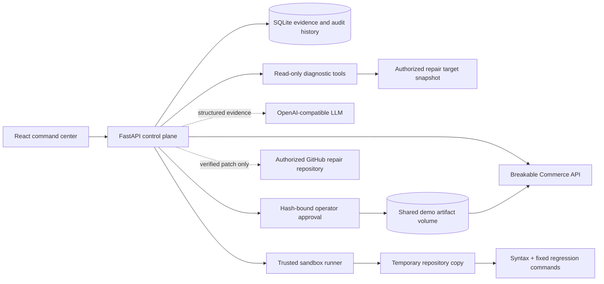

# AutoSRE AI — Autonomous AI On-Call Engineer

AutoSRE AI is a full-stack incident-response platform for the B3 AI On-Call Engineer challenge. Phase 2 preserves the original deterministic operational-recovery workflow and adds evidence collection, configurable LLM analysis, genuine source patching, a separate trusted test runner, GitHub pull requests, hash-bound human approval, patched-artifact deployment, health verification, and rollback.

## Architecture



The LLM can propose analysis and source content, but cannot access the host filesystem, shell, Docker daemon, credentials, deployment controller, or GitHub API. Trusted application code independently validates every path, schema, patch hash, test result, and approval.

## Implemented incident lifecycle

1. HTTP monitoring stores real health observations and deduplicates incidents.
2. Typed tools retrieve incident details, health checks, redacted logs, traceback lines, approved repository files, code search results, recent commits, and related incidents.
3. A configured LLM returns schema-validated facts, hypotheses, evidence references, affected files/functions, confidence, repair guidance, and limitations.
4. Invalid output, timeouts, missing credentials, and provider failures are explicitly labeled and fall back to deterministic evidence analysis.
5. The repair agent reads the authorized `pricing.py`, generates a genuine unified diff, compiles the proposed code, hashes the patch, and persists original and proposed sources.
6. The separate non-root sandbox runner checks the source snapshot and patch hash, copies the repository, records the failing baseline, applies the proposed source, compiles it, and runs fixed regression commands.
7. A verified patch may be published to an explicitly authorized GitHub repository as `autosre/fix-inc-NNNN`. It is never merged automatically.
8. An authenticated operator approves the exact tested SHA-256 patch.
9. The controller writes that artifact to the isolated demo volume. The demo loads the actual patched Python module and monitoring verifies its behavior.
10. Failed health verification restores the previous artifact and records a rollback.

The Phase 1 reset endpoint remains available through the separate operational-repair API and does not claim to be a code repair.

## Diagnostic tool allowlist

- `get_incident_details`
- `get_service_health`
- `get_recent_logs`
- `get_error_traceback`
- `list_repository_files`
- `read_repository_file`
- `search_repository_code`
- `get_recent_commits`
- `get_related_incidents`

Repository paths are resolved beneath `ALLOWED_REPOSITORY_ROOT`. Traversal, symlinks, binary extensions, credential filenames, excessive output, and malformed search input are rejected. Tool inputs and bounded summaries are persisted in the audit timeline.

## Quick start on Windows

Start Docker Desktop using its WSL 2 Linux engine, then:

```powershell
Copy-Item .env.example .env
docker compose up --build
```

Open:

- Command center: http://localhost:5173
- FastAPI/OpenAPI: http://localhost:8000/docs
- Demo API: http://localhost:9000

Ports remain 5173, 8000, and 9000. The sandbox runner is on an internal Docker network and is not published to the host.

## LLM configuration

The default is a free deterministic fallback:

```env
LLM_PROVIDER=heuristic
```

For an OpenAI-compatible provider:

```env
LLM_PROVIDER=openai_compatible
LLM_BASE_URL=https://api.openai.com/v1
LLM_API_KEY=your-secret
LLM_MODEL=your-available-model
LLM_TIMEOUT_SECONDS=60
LLM_MAX_TOOL_CALLS=12
LLM_MAX_RETRIES=2
```

No paid request is required by the automated suite. Provider content is treated as untrusted and parsed through Pydantic. The UI always labels `llm` versus `heuristic`; fallback results are never presented as LLM output.

## GitHub repair authorization

Use a separate, deliberately vulnerable demo repository—not this platform repository—unless you explicitly intend it as the target. Configure a fine-grained token with contents and pull-request permissions only for that repository:

```env
GITHUB_TOKEN=<fine-grained-token>
GITHUB_REPAIR_REPOSITORY=owner/authorized-demo-repository
GITHUB_BASE_BRANCH=main
GITHUB_PR_ENABLED=true
```

With missing credentials or `GITHUB_PR_ENABLED=false`, local investigation, patching, testing, approval, deployment, and rollback remain available. The API returns a clear error and never fabricates a PR URL.

## Sandbox boundaries

The trusted runner is a separate read-only, non-root container with all Linux capabilities dropped, no Docker socket, no credentials, no published port, an internal network, a 256 MB memory limit, 0.5 CPU, 64-process limit, timeouts, and a temporary 128 MB writable filesystem. It executes only fixed commands selected by trusted code:

```text
python -m compileall -q .
python -m pytest -q
```

LLM-generated shell commands are never accepted. The current runner supports the authorized Python pricing target; adding another repair target requires a deliberate policy/code change.

## API additions

- `POST /api/incidents/{id}/investigate`
- `GET /api/incidents/{id}/evidence`
- `POST /api/incidents/{id}/generate-patch`
- `POST /api/incidents/{id}/operational-repair`
- `GET /api/incidents/{id}/timeline`
- `GET /api/repairs/{id}/diff`
- `POST /api/repairs/{id}/test`
- `GET /api/repairs/{id}/test-results`
- `POST /api/repairs/{id}/create-pr`
- `POST /api/repairs/{id}/approval`
- `POST /api/repairs/{id}/recover`
- `POST /api/repairs/{id}/rollback`
- `GET /api/metrics`

Mutating endpoints require `X-API-Key`. Database startup performs additive SQLite migrations and preserves existing Phase 1 incident history.

## Automated tests

```powershell
$env:PYTHONPATH="backend;demo-app;sandbox-runner"
pytest -q backend/tests demo-app/test_app.py sandbox-runner/test_runner.py

Set-Location frontend
npm install
npm run build
```

CI runs the same deterministic tests, the frontend production build, and Compose validation. Real-provider testing is optional and requires credentials.

## Live hackathon demonstration

1. Start Compose and open the command center.
2. Click **Inject pricing defect**. The demo invokes the vulnerable `calculate_discount(100, 0)` and emits a real `ZeroDivisionError`/HTTP 500.
3. Open the detected incident and click **Investigate**. Show recorded logs, source evidence, tool calls, analysis mode, model, and confidence.
4. Click **Generate code patch**. Show original/proposed code, unified diff, regression test, and SHA-256 hash.
5. Click **Run isolated tests**. Show the recorded failing baseline, syntax result, and patched regression results.
6. Optionally click **Create PR** when an authorized repair repository is configured.
7. Click **Approve exact patch**. Approval records the operator, incident, test run, target, and patch hash.
8. Click **Deploy patched artifact**. The demo loads the new Python source; its guard converts the zero-divisor condition into controlled behavior.
9. Show the real healthy observation, resolved incident, measured MTTR, audit timeline, and report.
10. For the legacy demonstration, use the operational-repair route to reset the isolated failure without claiming a code change.

## Known limitations

- The source-repair policy is intentionally scoped to the authorized `pricing.py` demo target. It is not an arbitrary repository coding agent.
- The in-process background monitor is sufficient for the hackathon; a durable production queue would be required for multi-instance workers.
- GitHub PR creation cannot be exercised without an explicitly authorized target repository and token.
- Docker runtime verification requires Docker Desktop’s Linux engine to be running. The repository never starts or modifies Docker Desktop automatically.
